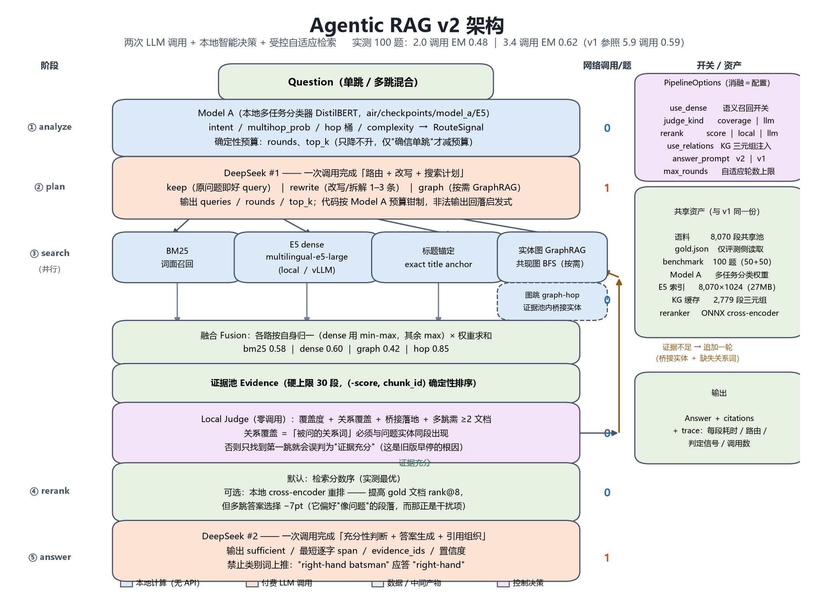

# Agentic RAG v2

**两次 LLM + 本地智能决策 + 受控自适应检索。**

一个简单的单跳问题只花 2 次网络调用、1 轮检索就结束；一个需要桥接的多跳问题
在同一 2 次调用预算内，把额外的算力花在**本地**检索、重排和判定上，而不是继续堆 LLM 轮次。



> 架构图：[`docs/architecture.png`](docs/architecture.png)（SVG 同目录；Mermaid/文字版见
> [`docs/architecture.md`](docs/architecture.md)；由 [`docs/make_architecture.py`](docs/make_architecture.py) 生成）
>
> 归因报告：[`docs/EM_GAP_ANALYSIS.md`](docs/EM_GAP_ANALYSIS.md) —— 为什么 v2 初版 0.48 而 v1 是 0.59、
> 两条真原因 + 三条被否掉的假设、以及 0.62 的修正路径（附[逐题明细](docs/EM_GAP_APPENDIX.md)）
>
> 质量审计：[`docs/QUALITY_AUDIT_2026-11-16.md`](docs/QUALITY_AUDIT_2026-11-16.md) ——
> 数据泄露核查与去泄露重训、Model A 无条件化、plan/judge 输出契约、向量缓存五个缺陷、
> 融合层重复计票实测（94/100 题）、修复后真实重跑
>
> 提升计划：[`docs/PLAN_2026-11-16.md`](docs/PLAN_2026-11-16.md) ——
> 41 个失败的逐类拆解（31/41 正确 span 已在池里）、chunking 结构评估（不重切语料）、
> **KG 按需启用**设计（门控 + 5 个消融臂）、P0~P4 分阶段路线
>
> P1 实验报告：[`docs/P1_AB_2026-11-16.md`](docs/P1_AB_2026-11-16.md) ——
> 答案侧 3 项改动经 **3 次重复**测得 EM **0.610 → 0.640**（+3pt，从不更差），
> 并给出"单批次 100 题噪声 sd≈1.4pt"的方法论修正

```
Question
   │
   ▼ ① analyze      Model A（本地 DistilBERT 多任务分类，无网络）
   │                intent / multihop_prob / hop / complexity
   │                 → RouteSignal + 确定性预算（轮数、top_k、答案块容量）
   ▼ ② plan         DeepSeek #1（唯一一次"规划"调用）
   │                一次输出：路由 keep|rewrite|graph + 改写查询(1-3) + 是否走 GraphRAG
   │                + rounds + top_k + 理由
   ▼ ③ search       本地多路并行检索（无 LLM）
   │                routes: bm25 ‖ dense(E5 语义) ‖ title-anchor ‖ graph(按需) ‖ graph-hop
   │                融合 → 证据池 → Local Judge 判断覆盖度 → 不够才追加一轮
   ▼ ④ rerank       默认：检索分数序（v1 实测最优）
   │                可选：本地 cross-encoder（更"像问题"的段排前，多跳下 −7pt）
   ▼ ⑤ answer       DeepSeek #2（唯一一次"生成"调用）
   │                一次输出：证据是否充分 sufficient + 最短逐字答案 + evidence_ids 引用
   ▼
Answer + citations + 全链路 trace（每段耗时、路由、判定信号、调用数）
```

## 1. 成本模型

| 段 | 是否走网络 | 每题次数 | 说明 |
|---|---|---|---|
| ① analyze (Model A) | 否 | 0 | 本地 GPU 推理 ~3ms |

**Model A 不可关闭**：它是流水线的硬依赖，`PipelineOptions` 里没有 `use_model_a`，
`AgenticRAG` 构造时若 checkpoint 加载失败会直接 `raise`（不再回落到"中性信号"）。
所有评测臂（含 `v2_direct` 无检索下界）每道题都必须先过第一段，
这样任意两臂之间只差"第一段之后"的东西，对比才成立。
权重默认用 `E6`（去泄露重训，见 `docs/QUALITY_AUDIT_*.md`）。
| ② plan (DeepSeek) | 是 | **1** | 路由 + 改写 + 计划 |
| ③ search | 否 | 0 | 多路并行召回（含 E5 语义召回）+ 本地覆盖度判定 |
| ④ rerank | 否 | 0 | 默认分数序（0 开销）；CE 可选，每段约 2ms |
| ⑤ answer (DeepSeek) | 是 | **1** | 充分性 + 答案 + 引用 |

语义召回本身也不花钱：要么进程内跑 E5（query 一次前向约 8ms），要么请求本地
vLLM 容器（一次 HTTP 约 40ms）；两者都不消耗外部 API 额度。

`PipelineResult.llm_calls` 恒为 2；若某次运行超过
`config.LLM_CALLS_PER_QUESTION`，trace 里会出现 `{"stage": "budget", "warning": ...}`。
消融臂（LLM judge / LLM rerank）会各多 1 次，这在记录里是显式可见的。当前最优的 3.4 调用档见 §9.4。

## 2. 受控自适应：简单题快速结束，复杂题多给资源

三个控制点，全部是**确定性、可审计**的：

1. **Model A 给预算**（`stages/analyze.py`）
   - `hop=1` 或 `multihop_prob<0.35` → 1 轮、`top_k=6`
   - `hop=2` → 2 轮、`top_k=8`；`hop=3+` → 3 轮、`top_k=10`
   - `complexity=high` 再 +1 轮 / +2 top_k，上限 `MAX_ROUNDS=4`
   - 规则是**非对称**的：只有"确信单跳"能减少工作量，其余拿默认上限。
     （v1 实测：3 轮上限下让路由自由加轮数，100/100 题被钳成常数，等于没改。）
2. **plan 只能在下限之上收紧**（`stages/plan.py`）
   - LLM 给 rounds/top_k，代码再按预算钳制；无效 JSON → 确定性启发式兜底；
     `keep` 模式下查询强制等于原问题，且不允许打开 graph。
3. **Local Judge 决定要不要下一轮**（`models/judge.py::CoverageJudge`）
   - 三条可解释信号，全部确定性、零 API：
     - `token_coverage`：问题内容词（去掉关系词/停用词）在证据池里的覆盖率；
     - `best_passage_coverage`：**单段**最高覆盖（确认"有一段真的在讲这个问题"）；
     - `entity_coverage`：问题命中的实体是否出现在已检索块中；
     - `bridge_resolved`：多跳专用——取最强段落里"问题没提到"的实体作为候选桥接实体，
       若证据池中**另一篇文档以该实体为标题**（即第二跳的落点）则视为链路打通，
       否则判为不足（v2 实测：仅靠词覆盖会把"只找到第一跳"的题误判为充分）。
   - 判为不足时，用 **桥接实体 + 最强段落里缺失的问题词** 拼一个确定性补充 query 再来一轮；
     该轮只花本地算子，不增加 LLM 调用；若某轮没有新增证据则立即停止。
   - `plan.mode == graph` 时，Model A 的轮数是**下限**（本地轮次免费），
     简单题仍由 hop=1 预算和"覆盖即停"保护。

## 3. 为什么这样设计（针对 v1 的实测结论）

| v1 结论 | v2 的处理 |
|---|---|
| Model A 控轮数在 3 轮上限下退化为常数 | Model A 只做"预算先验"，并且只降不升；graph 路线下预算成为下限 |
| TF-IDF 选段把复述问题的干扰段排到前面（答案在块里只有 16/100） | 答案块直接给检索分数序（v2 实测：再套一层 CE 重排反而 −7pt，见 §9.3） |
| 控制器与答案生成器看到不同顺序的证据 | judge 只看分数序摘要，重排后答案块整体按重排序（单一视图） |
| 答案加类别词（"right-hand batsman"）是主要近失 | 沿用"最短逐字 span"协议 + 确定性答案清洗 |
| 语义 KG 每题 +2 次调用、约 8s，收益未测到 | 默认不开；GraphRAG 走实体共现图（本地、0 调用） |
| 多跳题的失败多为"只找到第一跳" | 本地 bridge 检测把这类题判为不足并追加一轮（见上） |
| 并发下 set 迭代导致逐题漂移 | 全链路 `(-score, chunk_id)`、`sorted(entities)` 确定性排序 |

## 4. 语义检索（multilingual-e5-large）

第三条召回路线 `dense`，与 BM25 / 标题锚定 / 实体图并行执行，然后把各路分数归一化后线性融合
（`_fuse`：`bm25 0.58 / dense 0.60 / graph 0.42 / hop 0.85`，标题锚定用绝对 boost）。

```
语料 8070 段 ──► E5 passage 向量（1024-d，L2 归一化）──► 缓存 work/embeddings/<slug>.npz (27MB)
问题 ──► "query: …" ──► 一次前向 ──► 与全部 passage 做点积 ──► top-k（精确检索，非 ANN）
```

为什么是精确检索：8070 × 1024 float32 只有 33MB，一次全量点积远小于 1ms，ANN 只会引入
近似误差和不确定性。缓存 key 覆盖「模型目录 + backend + 维度 + 语料内容指纹」，
且向量与 ids 分文件存放（`.npz` 只放 float32 矩阵 + `.json` sidecar 放 ids，`allow_pickle=False`），
加载时逐项校验 dimension / chunk 数 / fingerprint / embedder identity，任一不符即视为
stale 并重建，不会悄悄用旧向量（详见审计文档第 4 节）。

### 4.1 两种后端，同一接口

| 后端 | 实现 | 首次构建 | 单次 query | 依赖 |
|---|---|---|---|---|
| `local`（默认） | transformers + mean pooling，进程内 | 22s（8070 段） | ~8ms | 无 |
| `vllm` | vLLM OpenAI 兼容 `/v1/embeddings` | 20s | ~40ms HTTP | 容器 |

```powershell
# 后端选择
$env:RAGV2_EMBED_BACKEND = "vllm"        # local | vllm
$env:RAGV2_EMBED_ENDPOINT = "http://127.0.0.1:18000/v1"

# E5 权重位置：仓库内 models/multilingual-e5-large 会被自动找到，
# 放在别处（例如挂载的模型卷）时必须显式给一个：
$env:RAGV2_E5_DIR      = "<MODELS_DIR>/multilingual-e5-large"   # 首选位置
$env:RAGV2_E5_DIR_VLLM = "<MODELS_DIR>/multilingual-e5-large"   # 备用位置（vLLM 卷）
```

> 不设这两个变量且仓库内没有权重时，`dense` 路由会打印
> `[semantic:local] UNAVAILABLE …` 并静默退化成纯词法检索 —— 看 manifest 的
> `semantic` 字段确认它是否真的启用了。

### 4.2 用 G 盘的 vLLM 起 embedding 服务

G 盘那套是「WSL Ubuntu-24.04 + Docker CE（vhdx 在 G:）+ nvidia-container-toolkit +
`vllm/vllm-openai:latest` 镜像」，模型卷挂在 `/path/to/models`。关键点是
**这是 embedding 模型，不是生成模型**，所以要显式指定 pooling 运行器：

```bash
docker run -d --name vllm-e5 --gpus all --ipc=host \
  -v /path/to/models:/models \
  -p 18000:8000 \
  vllm/vllm-openai:latest \
  /models/multilingual-e5-large \
  --runner pooling \
  --pooler-config '{"pooling_type":"MEAN"}' \
  --served-model-name multilingual-e5-large \
  --max-model-len 512 --dtype float16 --gpu-memory-utilization 0.25
```

三个容易踩的坑（都已固化进 `scripts/serve_vllm_embed.sh`）：

1. `--runner pooling`（0.32 版把它叫 runner，旧的 `--task embed` 已弃用），模型路径必须是
   **容器内**路径 `/models/…`，不是宿主机的 `/path/to/models/…`。
2. vLLM 默认 **CLS** pooling，而 E5 是 **mean** pooling。不显式设
   `--pooler-config '{"pooling_type":"MEAN"}'`（注意大写）会得到另一套向量，检索质量下降。
3. **WSL 空闲会自动关闭整个发行版**，容器随之收到 SIGTERM：`docker run -d` 之后如果长时间
   没有 WSL 前台进程，服务会"自己消失"。要么在前台会话里跑（脚本默认行为，推荐），
   要么保持一个 `wsl -d Ubuntu-24.04 -e sleep infinity` 常驻。

```powershell
# 一键启动（前台，Ctrl+C 结束；脚本会自动等 /v1/models 就绪）
wsl -d Ubuntu-24.04 -e bash -lc "bash /path/to/repo/scripts/serve_vllm_embed.sh --port 18000"
powershell -File agentic_rag_v2/scripts/serve_vllm_embed.ps1 -Detach      # 或后台模式（需自行保活 WSL）
powershell -File agentic_rag_v2/scripts/serve_vllm_embed.ps1 -Stop
```

首次加载约 2.5 分钟（含 torch.compile），之后 `docker start vllm-e5` 复用编译缓存会快很多。

### 4.3 两种后端的一致性（实测）

同一段文本，vLLM 与本地向量的余弦相似度 **0.997–1.000**（fp16 舍入差），
40 题端到端逐题对比：**EM/F1/证据召回完全相同，38/40 题排序完全相同，40/40 题答案一致**，
延迟 2.42s vs 2.62s。所以 `local` 是默认（少一个依赖），`vllm` 是可替换的生产形态。

## 5. 目录结构

```
agentic_rag_v2/
  config.py           # 路径、预算、阈值、E5 目录/后端、reranker 目录、PROMPT_VERSION
  types.py            # RouteSignal / StageBudget / SearchPlan / Evidence / JudgeVerdict / AnswerResult
  llm.py              # Ark 客户端（缓存 / 重试 / 用量账本）+ ChatClient 协议
  prompts.py          # PLAN / JUDGE / RERANK / ANSWER / DIRECT
  data.py             # 语料 + benchmark + gold（默认复用 agentic_rag/work）
  retrieval/
    text.py lexical.py graph.py engine.py   # BM25 / 实体图 / 标题锚定 / 融合
    vector.py         # E5 向量索引：构建/缓存/精确余弦检索 + SemanticRetriever
  models/
    model_a.py        # Model A 适配器（air/checkpoints/model_a/E6，去泄露重训；require() 硬校验）
    embedder.py       # local / vLLM 两种 E5 后端 + "query:/passage:" 前缀 + query 缓存 + identity()
    reranker.py       # 本地 cross-encoder（ONNX 或 transformers 权重）
    judge.py          # CoverageJudge（默认）/ LocalJudgeAdapter(JEV) / LLMJudge / StubJudge
  stages/
    analyze.py plan.py search.py rerank.py answer.py
  pipeline.py         # 编排 + PipelineOptions（消融开关，含 use_dense / embed_backend）
  eval/               # 指标（与 v1 一致）+ 多系统 runner
  scripts/            # smoke.py / run_eval.py / analyze.py / build_embeddings.py
                      # audit_leakage.py / make_clean_split.py / eval_model_a_holdout.py
                      # audit_fusion.py / audit_answer_headroom.py / compare_repeats.py
                      # diagnose_gap.py
                      # serve_vllm_embed.sh|ps1
  tests/              # 107 个离线单测（scripted LLM / fake reranker / fake embedder）
```

## 6. 运行

```powershell
$PY = "<PYTHON_EXE>"

# 单测（离线，含 dense 路由的 fake embedder 测试）
& $PY -m pytest agentic_rag_v2/tests -q

# 语义索引：首次构建（~22s）+ 检索质量自检（dense vs bm25 的 gold 文档召回）
& $PY agentic_rag_v2/scripts/build_embeddings.py --verify
& $PY agentic_rag_v2/scripts/build_embeddings.py --backend vllm --verify   # 走容器

# 冒烟（真实 API + 真实语料 + Model A + E5 语义检索）
& $PY agentic_rag_v2/scripts/smoke.py --n 3 --trace

# 评测（同批配对）
& $PY agentic_rag_v2/scripts/run_eval.py --systems v2_full,v2_no_dense --tag v2dense
& $PY agentic_rag_v2/scripts/run_eval.py `
    --systems v2_full,v2_llm_judge,v2_no_dense,v2_ce_rerank,v2_kg,v2_no_planner,v2_keep,v2_direct `
    --tag v2ab

# 配对分析（EM/F1、胜负、McNemar、gold 文档 recall@k）
& $PY agentic_rag_v2/scripts/analyze.py --tag v2confirm --base v2_full --vs v2_llm_judge --diffs
& $PY agentic_rag_v2/scripts/diagnose_gap.py `
    --base agentic_rag/results/v9ab/agent_graph_semantic_v6_span30.jsonl `
    --vs agentic_rag_v2/results/v2confirm/v2_full.jsonl

# 质量审计（见 docs/QUALITY_AUDIT_2026-11-16.md）
& $PY agentic_rag_v2/scripts/audit_leakage.py          # 训练/评测重叠
& $PY agentic_rag_v2/scripts/make_clean_split.py --dry-run
& $PY agentic_rag_v2/scripts/eval_model_a_holdout.py --checkpoints E5,E6
& $PY agentic_rag_v2/scripts/audit_fusion.py           # 融合重复计票的影响面

# P1：重复实验对比（单批次噪声 sd≈1.4pt，必须 3 次重复）
& $PY agentic_rag_v2/scripts/compare_repeats.py `
    --base v2_llm_v2prompt --vs v2_llm_judge --tags p1_ab,p1_rep2,p1_rep3

# 提升计划基线测量（见 docs/PLAN_2026-11-16.md §1）
& $PY agentic_rag_v2/scripts/audit_answer_headroom.py `
    --records agentic_rag_v2/results/audit_rerun/v2_llm_judge.jsonl

# live 集成测试（含 vLLM 一致性校验）
$env:RAGV2_LIVE = "1"
$env:RAGV2_VLLM_ENDPOINT = "http://127.0.0.1:18000/v1"
& $PY -m pytest agentic_rag_v2/tests/test_live.py -q
```

## 7. 消融系统

| 系统 | 与 `v2_full` 的差异 |
|---|---|
| `v2_full` | Model A + plan + 多路检索（bm25/dense/图/标题）+ 本地 judge + 分数序答案块 + answer（2.0 调用） |
| `v2_llm_judge` | judge 换成 DeepSeek assess（v1 式"缺什么/下一句查什么"，3.4 调用，当前最优 0.62） |
| `v2_no_dense` | 去掉语义召回 |
| `v2_vllm` | 语义召回改走 vLLM 容器（其余相同） |
| `v2_ce_rerank` | 答案块改由本地 cross-encoder 排序（LLM-judge 档 −7pt；2 调用档 0） |
| `v2_kg` | 往答案提示注入缓存的 KG 三元组（三种配置 −3/+2/−3，噪声级） |
| `v2_no_rel` | `v2_full` 的显式写法（KG 关，默认值） |
| `v2_v1prompt` | 换用 v1 的 `_ANSWER_V5` 提示词（实测净 0） |
| `v2_rounds4` | 轮数上限放到 4（实测与默认逐题一致：judge 早停，预算用不满） |
| `v2_llm_judge_norerank` | LLM judge + 分数序（`v2_llm_judge` 的显式写法） |
| `v2_llm_judge_kg` | LLM judge + 分数序 + KG 注入（用于检验关系注入在最优档是否有害） |
| `v2_no_judge` | 去掉 judge（固定一轮） |
| `v2_llm_v2prompt` | LLM judge + v2 答案提示词 + 关掉比较题路由（= P1 之前的旧行为） |
| `v2_llm_v2prompt_compare` | LLM judge + v2 提示词，只开比较题路由 |
| `v2_llm_v3prompt` | LLM judge + v3 提示词（候选答案 + 校验器），关掉比较题路由 |
| `v2_no_planner` | 去掉规划 LLM（确定性启发式路由） |
| `v2_keep` | 强制 keep 路线 |
| `v2_direct` | 无检索下界（**仍然走 Model A**：没有任何臂能绕过第一段） |

## 8. 接入 JEV 类本地判定模型

```python
from agentic_rag_v2.models.judge import LocalJudgeAdapter
from agentic_rag_v2.pipeline import AgenticRAG

def jev(question, evidence):
    # 你的模型：输入问题 + 证据摘要，输出充分性
    return {"sufficient": bool(pred), "missing": "...", "next_query": "...", "score": 0.42}

rag = AgenticRAG(judge=LocalJudgeAdapter(jev))
```

接口只有一个方法 `judge(question, evidence) -> JudgeVerdict`，不计 LLM 调用，
因此"手写覆盖度 judge"与"JEV 模型 judge"可以在同一批次里直接配对比较。

## 9. 验证结果

### 9.1 语义召回消融（tag `v2dense`，100 题同批配对，**旧默认件**）

`python agentic_rag_v2/scripts/diagnose_gap.py --base .../v2_no_dense.jsonl --vs .../v2_full.jsonl`

| 系统 | EM | F1 | 证据召回 | 排序 recall@8 | 调用/题 | 配对 |
|---|---|---|---|---|---|---|
| **v2_full（含 E5 dense）** | **0.480** | **0.608** | **0.829** | **0.761** | 2.0 | +11/−5，p=0.210 |
| v2_no_dense | 0.420 | 0.558 | 0.798 | 0.700 | 2.0 | 基准 |

- 纯检索层面（40 题，`build_embeddings.py --verify`）：gold 文档召回
  **dense@8 = 0.800 vs bm25@8 = 0.700**，@4 是 0.725 vs 0.613 —— 语义召回确实补上了
  纯词面匹配漏掉的段落。
- 端到端 +6pt EM / +5pt F1 / +3pt 证据召回，净胜 6 题；p=0.21 说明 100 题还不足以
  把这个量级的差判成显著（与 v1 的 ±9pt CI 一致）。
- 逐题 Deltas 里有 3 例从 `UNKNOWN` 变成正确答案（hp-040 / mq-004 / mq-047），
  也有 5 例反向（语义把相近但错误的实体排前）——这正是需要重排兜底的地方。
- 该批用的是"CE 重排"旧默认；9.4 修正默认后，dense 的增益方向不变。

### 9.2 后端一致性（tag `v2vllm`，40 题同批配对）

| 系统 | EM | F1 | 证据召回 | 延迟 ms |
|---|---|---|---|---|
| v2_full（local E5） | 0.475 | 0.586 | 0.863 | 2420 |
| v2_vllm（容器 E5） | 0.475 | 0.586 | 0.863 | 2616 |

逐题：**40/40 预测一致，38/40 排序完全一致**；同文本向量余弦 0.997–1.000。

### 9.3 为什么 v1 能到 0.59、v2 只有 0.48：归因与修正

同一批 100 题，用 `scripts/diagnose_gap.py` 把差距拆成"检索没找到"与"找到了但答错"两类：

```
metric                  v1_v6_span30         v2_full(旧默认)
em                              0.590            0.480
recall                          0.868            0.829
perfect_recall                    75               65
em_when_perfect                 0.720            0.631
lost_by_retrieval                 25               35
lost_by_answer                    21               26
calls                            5.9              2.0
pool_median / block_median     30 / 29.5        30 / 30
```

容量不是原因（证据池中位数、答案块中位数完全一样）。真正的**两个**原因，都是**可替换件**
（第三条"KG 注入有害"在复核后被撤回，见下）：

| # | 原因 | 证据 | 修正 |
|---|---|---|---|
| 1 | **控制器是"看词在不在"，v1 是"看事实能不能推出来"**：本地 judge 1 轮就收工（33/100 题只跑 1 轮） | 换回 LLM assess：EM **0.48 → 0.62**（与第 2 项叠加），证据召回 0.844 → **0.921**，perfect recall 68 → 83 | `judge_kind="llm"`（3.4 调用） |
| 2 | **答案块的编号顺序是个强杠杆，且方向反直觉**：同一证据池、同一轮数、同一 judge，只改顺序就有 **22/100 题答案变化（8 负 1 胜）** | LLM judge 同一批次：分数序 **0.62** vs CE 序 **0.55**；2 调用档则是 0.48 vs 0.49（无差异） | 默认 `rerank="score"`，CE 降级为 `v2_ce_rerank` |

**被数据否掉的三个怀疑**（写在这里避免下次再犯）：

- **答案提示词**：换成 v1 的 `_ANSWER_V5` 后 **+4/−5，净 0**（修好 3 个"加类别词"，
  又引入 5 个单复数/介词型近失）。不是原因。
- **轮数预算**：`max_rounds=4` 与默认**逐题完全一致**——本地 judge 早早就判"够了"，
  预算从来没用满。问题不在预算，在**判定**。
- **KG 三元组注入**：早先测到 −3pt，但那是 CE 序下的结果；换成默认分数序后是
  **+3/−1（+2pt）**，在最优配置（LLM judge）下又是 **+0/−3（−3pt）**。
  三次都在 ±3 题的噪声内 → **它不是一个原因**，默认关闭只是为了少一个活动部件。

### 9.4 修正后的最终结果（tag `v2confirm`，100 题同批）

| 配置 | EM | F1 | 证据召回 | perfect recall | LLM 调用/题 |
|---|---|---|---|---|---|
| v1 `agent_graph_semantic_v6_span30`（参照） | 0.590 | 0.654 | 0.868 | 75 | 5.9 |
| **v2_full**（2 调用：本地 judge + 分数序 + dense） | 0.480 | 0.607 | 0.844 | 68 | **2.0** |
| **v2_llm_judge**（3.4 调用：LLM judge + 分数序 + dense） | **0.620** | **0.730** | **0.921** | **83** | **3.4** |

结论：**架构本身没问题，是两处默认件选错了。** 换回"用一次 LLM 判定"并把答案块恢复到
检索分数序之后，v2 在同一批题上 **0.62 > 0.59**，而调用数是 **3.4 < 5.9**。

真正的代价在 2 调用档：把判定压成启发式要付 **14pt EM**。这不是架构缺陷，是这个预算下
的客观上限——想让 2 调用档变好，唯一有效的方向是把启发式 judge 换成**训练过的本地判定模型**
（JEV 接口已留好），或让本地 judge 学会 v1 assess 那种"改写而非机械拼接"的下一条查询。

### 9.5 旧批次参考（tag `v2ab`，dense 与修正前）

| 系统 | EM | F1 | 证据召回 | 排序 recall@8 | 调用/题 |
|---|---|---|---|---|---|
| v2_full（旧默认，CE 重排） | 0.450 | 0.585 | 0.808 | 0.741 | 2.0 |
| v2_no_rerank（分数序） | 0.450 | 0.566 | 0.808 | 0.629 | 2.0 |
| v2_no_judge | 0.410 | 0.524 | 0.753 | 0.706 | 2.0 |
| v2_no_planner | 0.360 | 0.484 | 0.747 | 0.703 | 1.0 |
| v2_keep（强制单路） | 0.400 | 0.512 | 0.746 | 0.682 | 1.0 |
| v2_direct（无检索） | 0.090 | 0.183 | – | – | 1.0 |

这批给出的稳定结论：规划 LLM 是最有价值的一段（去掉 −9pt）、强制单路 −5pt、
Model A 端到端中性（0/0 逐题一致）。**注意这批的数字不能与 9.4 横向比较**（代码与默认件已改）。

## 10. 已知取舍

- **2 调用档的真实瓶颈是判定，不是检索**：把 judge 从启发式换成一次 LLM 判定，
  EM 从 0.48 到 0.62（+15/−1 配对），代价是 2.0 → 3.4 次调用。想让 2 调用档接近，
  唯一有效方向是训练过的本地判定模型（`LocalJudgeAdapter` 已留接口），
  或让本地 judge 学会 v1 assess 那种"改写查询"而不是机械拼接。
- **cross-encoder 不适合给多跳答案块排序**：它提高的是 gold 文档 recall@8（0.629→0.741），
  但会优先推"像问题"的段落，而多跳里那通常是干扰项。因此默认改为检索分数序，
  CE 保留为 `v2_ce_rerank` 消融臂。
- **KG 三元组注入在 v2 里是负收益**：v1 的提示词下中性偏好，v2 的答案 schema 下会诱导
  模型回答"相关实体"（+1/−4）。默认关闭，保留 `v2_kg` 消融臂与缓存复用能力。
- **语义召回默认走进程内 E5**：少一个运行依赖，延迟更低；需要"encoder 集中成服务"时切
  `vllm` 后端（数值等价已实测）。索引首次构建约 20s，之后走 27MB 缓存。
- **WSL 空闲会把 vLLM 服务带走**：容器在 WSL 发行版里，没有前台 WSL 进程时 WSL 会自行关闭。
  `serve_vllm_embed.sh` 默认前台运行就是为了避开这个坑；后台模式必须自己保活。
- **judge 是启发式覆盖度 + 桥接/关系检测**：它不判断语义上能否回答，只判断
  "词/实体是否覆盖"、"被问的关系是否与问题实体同段出现"、"第二跳是否落地"。
- **answer 段同时承担充分性判断**：`sufficient=false` 只作为记录信号，不会触发
  第三次调用重答（那会破坏 2 调用预算）。
- **答案提示词不是瓶颈**：v1 提示词在本批 +4/−5、净 0；100 题 ±9pt 的 CI 下这类
  2pt 级改动都不该当作结论。
- **答案块容量**默认 30 段 / 40k 字符：v1/v2 实测中位数都是 30 段、29.5–30，不是差距来源。
- **答案 schema 的取舍**：把 `sufficient/missing` 放进答案 JSON（本设计的明确要求）
  与 v1 的纯答案 schema 相比差异在噪声内，因此保留充分性判断。


"# agentic_RAG" 
