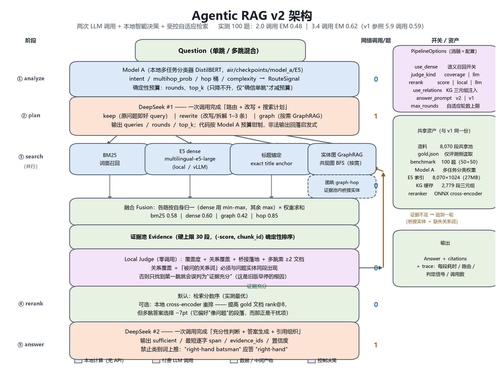
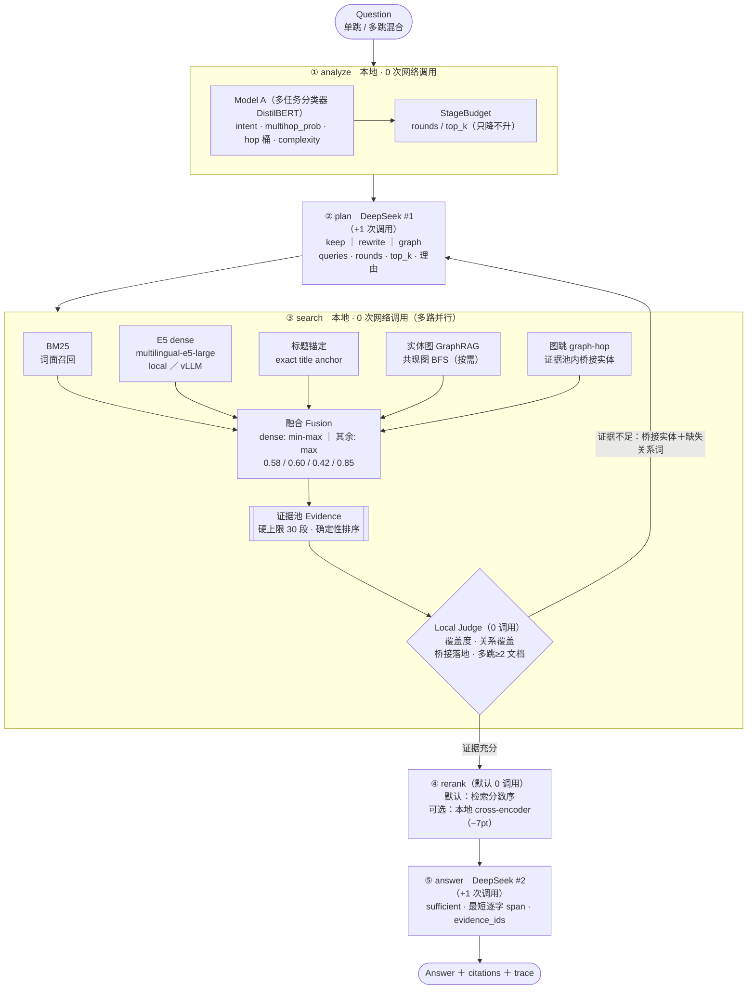

# Agentic RAG v2 —— 架构图

> 图片由 [`make_architecture.py`](./make_architecture.py) 生成（PNG + SVG），
> 改管线就重跑一次脚本，保证图与代码同步。
>
> 相关文档：[EM 差距归因](./EM_GAP_ANALYSIS.md) ｜
> [质量审计 `RAGV2-AUDIT-2026-11-16-001`](./QUALITY_AUDIT_2026-11-16.md)

## 1. 全景（Mermaid）

## 2. 每段的成本与职责

| 阶段 | 执行位置 | 网络调用/题 | 输入 → 输出 | 关掉之后 |
|---|---|---|---|---|
| ① analyze | 本地 GPU | 0 | question → `RouteSignal` + `StageBudget` | **不可关闭**（checkpoint 加载失败即启动失败） |
| ② plan | DeepSeek | **1** | question + signal + budget → `SearchPlan` | 确定性启发式（多跳→graph，否则 keep） |
| ③ search | 本地 CPU/GPU | 0 | plan → `Evidence` + verdicts | judge 去掉即固定一轮 |
| ④ rerank | 本地 | 0 | evidence → 顺序 | 默认就是分数序；CE 仅作消融 |
| ⑤ answer | DeepSeek | **1** | evidence + order → `AnswerResult` | —— 必经段 |

合计 **2.0 次/题**（judge 换成 LLM assess 时 3.4 次，见 §4）。

## 3. 数据流上的三个约束

1. **单一证据视图**：judge 的摘要与答案块同源同序（默认都是检索分数序），
   不会出现"控制器看到 A 顺序、答案模型看到 B 顺序"的错位。
2. **全链路确定性排序**：`(-score, chunk_id)`、`sorted(entities)`，
   两次运行、两个进程的 prompt 完全一致，缓存与逐题对比才可信。
3. **预算是硬门控**：LLM 给的 rounds/top_k 一律按 Model A 预算钳制；
   非法输出 → 启发式兜底，不会中断评测。

## 4. 实测（100 题 = HotpotQA 50 + MuSiQue 50，同批配对）

| 配置 | EM | F1 | 证据召回 | perfect recall | 调用/题 |
|---|---|---|---|---|---|
| v1 `agent_graph_semantic_v6_span30`（参照） | 0.590 | 0.654 | 0.868 | 75 | 5.9 |
| **v2（默认，2 调用）** | 0.480 | 0.607 | 0.844 | 68 | **2.0** |
| **v2 + LLM judge（3.4 调用）** | **0.620** | **0.730** | **0.921** | **83** | **3.4** |

## 5. 各段实测贡献（消融）

> 完整的差距归因（两条真原因、三条被否掉的假设、逐题明细）见
> [`EM_GAP_ANALYSIS.md`](./EM_GAP_ANALYSIS.md) 与 [`EM_GAP_APPENDIX.md`](./EM_GAP_APPENDIX.md)。

| 改动 | ΔEM | 说明 |
|---|---|---|
| 去掉规划 LLM（`no_planner` / `keep`） | −9pt / −5pt | 路由+改写+按需 GraphRAG 是最有价值的一段 |
| judge → LLM assess | **+14pt**（0.48→0.62） | 检索召回 0.844→0.921；瓶颈在"判定"不在"轮数" |
| 答案块改用 cross-encoder 排序 | −7pt（LLM judge 档）；0（2 调用档） | 同一证据池、同一轮数，仅换顺序就 22/100 题答案变化（8 负 1 胜） |
| 加 E5 语义召回 | +6pt | gold 文档 recall@8 0.70→0.80，0 额外调用 |
| judge 加"关系覆盖"信号 | +1pt | 修掉"只找到第一跳就判充分" |
| 注入 KG 三元组 | −3 / +2 / −3（三种配置） | 都在噪声内 → 不是原因，默认关 |
| 换 v1 答案提示词 | 0（+4/−5） | 修好 3 个"加类别词"，又引入 5 个近失 |
| 去掉 Model A | 0（逐题一致） | 目前只做先验与预算兜底；**该消融臂已删除**（Model A 不允许被绕过，见[质量审计 §2](./QUALITY_AUDIT_2026-11-16.md)） |
